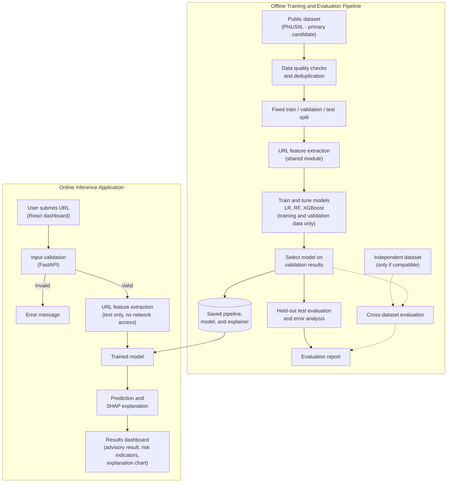

# AI CyberShield: Explainable AI-Based Phishing URL Detection

**Final Year Project Proposal**

| Item | Details |
|---|---|
| **Project Title** | AI CyberShield: Explainable AI-Based Phishing URL Detection |
| **Student Name** | Muhammad Shahzad |
| **Registration Number** | `[To be completed by student]` |
| **Degree Programme** | BS Information Technology (BSIT) |
| **Department** | Department of Information Technology |
| **University** | `[University name to be inserted]` |
| **Project Supervisor** | Dr. Salman Latif |
| **Academic Year** | 2026–2027 |
| **Proposal Status** | Draft submitted for initial supervisor review |

---

## Table of Contents

1. [Abstract](#1-abstract)
2. [Introduction and Background](#2-introduction-and-background)
3. [Problem Statement](#3-problem-statement)
4. [Aim and Objectives](#4-aim-and-objectives)
5. [Research Questions](#5-research-questions)
6. [Preliminary Literature Review](#6-preliminary-literature-review)
7. [Proposed Research Gap and Contribution](#7-proposed-research-gap-and-contribution)
8. [Proposed System and Features](#8-proposed-system-and-features)
9. [Scope and Limitations](#9-scope-and-limitations)
10. [Dataset Plan](#10-dataset-plan)
11. [Research Methodology](#11-research-methodology)
12. [Machine-Learning Models](#12-machine-learning-models)
13. [Explainable AI](#13-explainable-ai)
14. [System Architecture](#14-system-architecture)
15. [Proposed Technologies](#15-proposed-technologies)
16. [Evaluation Metrics](#16-evaluation-metrics)
17. [Functional and Non-Functional Requirements](#17-functional-and-non-functional-requirements)
18. [Feasibility Analysis](#18-feasibility-analysis)
19. [Project Timeline](#19-project-timeline)
20. [Ethical, Privacy, and Security Considerations](#20-ethical-privacy-and-security-considerations)
21. [Expected Outcomes and Deliverables](#21-expected-outcomes-and-deliverables)
22. [Conclusion](#22-conclusion)
23. [References](#23-references)
24. [Supervisor Approval](#24-supervisor-approval)

---

## 1. Abstract

Phishing remains one of the most common methods used to steal credentials, distribute malware, and commit financial fraud. Many phishing attacks depend on persuading a user to visit a deceptive web address, so the ability to assess a URL before it is opened is a useful layer of defence. Machine-learning classifiers trained on lexical and structural characteristics of URLs have been widely studied for this purpose and frequently report high accuracy. However, such results are often obtained on a single dataset, can be inflated by duplicate records or dataset-specific artefacts, and are usually presented without any explanation of why a particular URL was flagged.

This project proposes **AI CyberShield**, a web-based application that classifies a submitted URL as likely phishing or likely legitimate and explains the factors that most influenced each prediction. The system will extract features from the URL string alone, without opening, fetching, or executing the submitted address. Three supervised classifiers — Logistic Regression, Random Forest, and XGBoost — will be trained and compared on the PhiUSIIL Phishing URL Dataset, which is the primary candidate subject to verification of its suitability. Data will be deduplicated and split before any preprocessing is fitted, hyperparameters will be selected using training and validation data only, and final performance will be measured once on a held-out test set. Feature-level explanations will be generated using SHAP (SHapley Additive exPlanations) or a model-appropriate alternative and displayed alongside each prediction in a React-based dashboard served by a FastAPI backend.

Models will be evaluated using precision, recall, F1-score, false-positive rate, confusion matrices, and inference time. Where feature definitions and label conventions are confirmed to be compatible, the selected model will also be tested on an independent dataset to examine generalisation. The expected contribution is applied rather than theoretical: a reproducible, leakage-aware comparison of established classifiers, an honest account of cross-dataset behaviour where feasible, and a working tool that presents advisory predictions together with interpretable explanations and their limitations.

**Keywords:** phishing detection, URL classification, machine learning, explainable AI, SHAP, data leakage, cross-dataset evaluation

---

## 2. Introduction and Background

### 2.1 Phishing URL Attacks

Phishing is a form of social engineering in which an attacker impersonates a trusted entity to persuade a victim to disclose credentials, payment details, or other sensitive information, or to install malicious software. A common delivery mechanism is a link to a fraudulent website that imitates a legitimate service. Attackers use a range of techniques to make such URLs appear trustworthy, including look-alike domain names, excessive subdomains that place a familiar brand name early in the hostname, URL-shortening services, raw IP addresses in place of domain names, unusual top-level domains, and misleading path or query components.

Traditional defences such as blocklists are effective against known malicious addresses but cannot, by design, recognise a newly registered domain that has not yet been reported. This motivates complementary approaches that estimate the likelihood that an unseen URL is malicious based on its characteristics.

### 2.2 Machine Learning for Phishing Detection

Supervised machine learning treats phishing detection as a binary classification problem. A labelled set of phishing and legitimate URLs is converted into numerical features — for example, URL length, number of special characters, presence of an IP address, number of subdomains, or use of HTTPS — and a classifier learns a decision function that separates the two classes. Prior studies have applied a wide range of algorithms to this task, from linear models and decision-tree ensembles to deep neural networks operating on raw character sequences (Sahingoz et al., 2019; Prasad and Chandra, 2024).

### 2.3 The Need for Interpretable Predictions

A classifier that outputs only a label or probability offers little support to a user deciding whether to trust a link, or to an analyst investigating why the system raised an alert. Explainable AI (XAI) methods aim to make model behaviour more transparent. Feature-attribution techniques such as SHAP estimate how much each input feature contributed to a specific prediction (Lundberg and Lee, 2017). In a security setting, such explanations can help users understand a warning, help developers detect when a model relies on spurious signals, and support the broader principles of transparency and accountability described in the NIST AI Risk Management Framework (NIST, 2023).

### 2.4 Evaluation Beyond a Single Dataset

Results reported on a single dataset do not necessarily indicate how a model will perform on URLs collected from different sources or at different times. Datasets differ in how phishing and legitimate URLs were gathered, how labels were assigned, and which features were computed. A model may learn shortcuts tied to the collection process rather than to genuine indicators of phishing. Rashid et al. (2024) report that phishing URL classifiers can lose performance when evaluated on data from a different distribution, and broader work on machine learning in security and science has identified data leakage and sampling bias as common causes of over-optimistic results (Arp et al., 2022; Kapoor and Narayanan, 2023). Testing on an independent dataset, where this is methodologically valid, provides a more realistic indication of generalisation.

---

## 3. Problem Statement

Phishing URLs continue to be used to deceive users, and newly created malicious addresses are frequently absent from blocklists when they are first used. Machine-learning classifiers can assess unseen URLs, but three practical limitations reduce their usefulness:

1. **Opaque predictions.** Most classifiers provide a label or score without indicating which characteristics of the URL led to that decision. Users and analysts therefore cannot easily judge whether a warning is reasonable, and developers cannot easily detect when a model relies on irrelevant or artefactual signals.
2. **Potentially optimistic evaluation.** Reported performance can be inflated by duplicate or near-duplicate URLs appearing in both training and test data, by preprocessing or feature selection fitted on the full dataset before splitting, and by features that encode how a dataset was collected rather than whether a URL is malicious.
3. **Limited evidence of generalisation.** Models are commonly trained and tested on a single dataset, which provides limited evidence of how they will behave on URLs from other sources.

There is therefore a practical need for a phishing URL detection tool that (a) analyses URLs safely without visiting them, (b) is evaluated using a documented, leakage-aware procedure, (c) presents each prediction with an interpretable explanation, and (d) reports its limitations transparently, including its behaviour on independent data where this can be tested validly. This project addresses that need within the scope of a BSIT final-year project.

---

## 4. Aim and Objectives

### 4.1 Aim

To design, implement, and evaluate a web-based application that classifies URLs as likely phishing or likely legitimate using supervised machine learning, and that explains the main factors influencing each prediction, using a reproducible and leakage-aware evaluation procedure.

### 4.2 Objectives

1. **Review** relevant literature on phishing URL detection, dataset generalisation, data leakage, and explainable AI, and document the findings in a literature review chapter.
2. **Verify and select** a primary dataset by documenting its feature definitions, label encoding, class distribution, licence, and suitability for URL-only inference, and assess at least one additional dataset for compatibility as an independent test source.
3. **Prepare** the data by performing quality checks, removing exact duplicate URLs, applying a documented strategy for near-duplicate and same-domain records, and creating fixed training, validation, and test splits before any preprocessing is fitted.
4. **Implement** a URL feature-extraction module that computes all model features from the URL string alone, without network access, and verify it with unit tests.
5. **Train and compare** at least three classifiers — Logistic Regression, Random Forest, and XGBoost — with hyperparameters selected using training and validation data only, and select the final model based on measured validation results.
6. **Evaluate** the selected model once on the held-out test set using precision, recall, F1-score, false-positive rate, confusion matrix, and inference time, and conduct an error analysis of misclassified URLs.
7. **Assess generalisation** by evaluating the selected model on an independent dataset if feature compatibility and label conventions are confirmed; otherwise, document why cross-dataset evaluation was not feasible.
8. **Implement explanations** using SHAP or a model-appropriate alternative to show the most influential features for each prediction and for the model overall, and document the limitations of these explanations.
9. **Develop and test** a web application (React frontend and FastAPI backend) that accepts a URL, validates the input, returns a prediction with an explanation and risk indicators, and never opens or executes the submitted URL.

---

## 5. Research Questions

- **RQ1 — Model comparison:** How do Logistic Regression, Random Forest, and XGBoost compare in precision, recall, F1-score, false-positive rate, and inference time when trained and tested on a deduplicated, leakage-controlled split of the primary dataset using URL-derived features only?
- **RQ2 — Generalisation:** Where a compatible independent dataset is available, to what extent does the performance of the selected model change when it is evaluated on data from a different source, and which error patterns account for any change?
- **RQ3 — Explanations:** Which features most strongly influence the selected model's predictions according to SHAP (or the chosen alternative), are these influences consistent with known phishing indicators or do they reveal possible dataset artefacts, and what are the practical limitations of presenting such explanations to users?

---

## 6. Preliminary Literature Review

> This is a preliminary review prepared for proposal approval. A more comprehensive, systematic review will be conducted during the first phase of the project.

### 6.1 Phishing URL Detection with Machine Learning

Machine-learning detection of phishing URLs is an established research area. Sahingoz et al. (2019) constructed a large URL dataset and evaluated several classifiers, including Random Forest, on natural-language-processing features extracted from URLs, reporting that URL-based features alone can support effective classification. Mohammad, Thabtah and McCluskey (2012) proposed a set of phishing website features — covering address-bar characteristics, abnormal page elements, HTML and JavaScript behaviour, and domain-level properties — which underpins the widely used UCI Phishing Websites dataset (Mohammad and McCluskey, 2015). That dataset encodes engineered features rather than raw URLs and includes features that depend on page content and third-party services.

Prasad and Chandra (2024) introduced PhiUSIIL, a phishing URL detection framework based on a similarity index and incremental learning, together with a large dataset of legitimate and phishing URLs published on the UCI Machine Learning Repository. The dataset includes raw URL strings as well as features derived from both the URL and the web page source.

These studies establish that phishing URLs can be distinguished from legitimate URLs with machine learning on benchmark datasets. This project does not seek to show that phishing detection is possible; it seeks to compare established models carefully under controlled conditions.

### 6.2 Dataset Generalisation and Evaluation Pitfalls

High within-dataset accuracy does not guarantee performance on data from other sources. Rashid et al. (2024) studied the generalisation of phishing URL detectors across datasets and investigated unsupervised domain adaptation as a means of reducing performance loss under distribution shift. More broadly, Arp et al. (2022) identified recurring pitfalls in machine learning for computer security, including sampling bias, data snooping, spurious correlations, and inappropriate baselines. Kaufman et al. (2012) formalised data leakage — the introduction of information into model training that would not be legitimately available at prediction time — and Kapoor and Narayanan (2023) documented how leakage has affected the reproducibility of machine-learning-based research across many fields.

For URL datasets, relevant risks include duplicate URLs shared across splits, many URLs from the same domain appearing in both training and test data, legitimate and phishing samples collected from systematically different sources, and features computed from information that a deployed URL-only system would not have. This project will treat these risks as explicit parts of its methodology.

### 6.3 Explainable AI

Lundberg and Lee (2017) proposed SHAP, a unified framework for feature attribution based on Shapley values from cooperative game theory, which assigns each feature a contribution to a specific prediction relative to a baseline expectation. Lundberg et al. (2020) developed TreeSHAP, an efficient method for computing exact SHAP values for tree-ensemble models such as Random Forest and gradient-boosted trees. LIME (Ribeiro, Singh and Guestrin, 2016) is an alternative that approximates a model locally with an interpretable surrogate. These methods are mature and widely applied; their use in phishing detection is not novel. Their value in this project lies in making the deployed model's behaviour inspectable and in helping to identify reliance on dataset artefacts.

At the governance level, the NIST AI Risk Management Framework identifies explainability and interpretability, validity and reliability, and transparency among the characteristics of trustworthy AI systems (NIST, 2023). These principles inform the project's emphasis on explanations, honest reporting, and documented limitations.

### 6.4 Summary of Established Knowledge and Project Focus

| Established in prior work | What this project will evaluate |
|---|---|
| ML classifiers can detect phishing URLs on benchmark datasets. | Comparative performance of three established classifiers under a documented, leakage-controlled protocol using URL-only features. |
| Within-dataset results may not transfer to other data sources. | Cross-dataset performance of the selected model, only where compatibility is verified. |
| SHAP and similar methods can attribute predictions to features. | Whether attributions align with known phishing indicators or expose dataset artefacts, and how they can be presented responsibly to users. |
| Leakage and sampling bias can inflate reported performance. | The practical effect of deduplication and split strategy on the measured results (as an observation, not a pre-supposed outcome). |

---

## 7. Proposed Research Gap and Contribution

Based on the preliminary review, phishing URL detection, tree-ensemble classifiers, and SHAP-based explanations are each well established. This proposal does not claim to introduce a new algorithm or to be the first explainable phishing detector. A comprehensive literature review has not yet been completed, and any statement of a research gap at this stage is provisional.

The intended contribution is **applied and methodological**:

1. **Reproducible model comparison.** A documented, version-controlled pipeline that compares Logistic Regression, Random Forest, and XGBoost under identical, fixed data splits, with all preprocessing and hyperparameter selection confined to training and validation data.
2. **Leakage-aware evaluation.** Explicit handling of duplicate URLs, same-domain clustering, and features that would be unavailable to a URL-only system at inference time, with these decisions reported transparently.
3. **Consistency between training and deployment.** A single feature-extraction module used both to train the model and to process user-submitted URLs, so that reported evaluation reflects the behaviour of the deployed tool.
4. **Explanations with stated limitations.** Per-prediction and global feature attributions presented in a user-facing dashboard, accompanied by clear guidance that explanations describe model behaviour and do not establish intent or causality.
5. **Cross-dataset evaluation where feasible.** An assessment of generalisation on an independent dataset if compatibility is confirmed, or a documented account of why such evaluation was not possible.

---

## 8. Proposed System and Features

### 8.1 URL Submission and Input Validation

- The user enters a single URL in a text field in the web dashboard.
- The backend validates the input: maximum length limit, permitted characters, a parseable structure, and an allowed scheme (for example `http` or `https`). Inputs without a scheme may be normalised in a documented way.
- Invalid or malformed input is rejected with a clear, non-technical message.
- The submitted URL is treated strictly as text. **The system never opens, resolves, fetches, redirects to, or executes the submitted URL.**

### 8.2 URL Feature Extraction

- A Python module parses the URL into components (scheme, hostname, subdomains, top-level domain, path, query, fragment) using standard library parsing.
- It computes lexical and structural features such as overall and hostname length, counts of digits, letters, and special characters, number of subdomains, presence of an IP address, presence of `@` or `//` in unexpected positions, HTTPS usage, top-level domain characteristics, and character-distribution measures.
- The exact feature set will be finalised after the dataset is verified (Section 10). Only features that can be computed from the URL string without network access will be used by the deployed model.
- The same module will be used for both training-data preparation and live inference.

### 8.3 Machine-Learning Inference

- The trained model and its fitted preprocessing pipeline are serialised and loaded once when the API starts.
- For each request, extracted features are passed through the pipeline and the model returns a predicted class and a probability score.
- The decision threshold will be chosen on validation data and documented; by default it will balance precision and recall, and the trade-off will be reported.

### 8.4 Explainable AI

- For each prediction, the system computes feature attributions using SHAP (TreeSHAP for tree ensembles; a linear or model-agnostic explainer for Logistic Regression) or a suitable alternative if SHAP proves impractical.
- The dashboard displays the features that pushed the prediction most strongly towards "phishing" and towards "legitimate", with plain-language descriptions of each feature.
- A global explanation (for example, mean absolute SHAP values on the test set) is included in the evaluation report.

### 8.5 Prediction Results and Risk Indicators

- The result shows the predicted class, the model's probability score, and a risk band (for example, low / medium / high) derived from documented probability thresholds.
- Human-readable risk indicators summarise notable URL characteristics (for example, "hostname contains an IP address" or "unusually many subdomains").
- Every result includes a notice that the prediction is **advisory** and is not proof that a URL is malicious or safe.

### 8.6 Web Dashboard

- A single-page React application with a URL input form, a results panel, an explanation chart, and a short guide to interpreting results.
- A separate page presents the model evaluation summary (metrics, confusion matrix, and global feature importance) generated from the offline evaluation.

### 8.7 Optional Analysis History (Privacy-Conscious)

- If implemented, history will be **disabled by default** or stored only for the current browser session.
- Where server-side storage is used, the system will store the minimum necessary data, apply a defined retention period, and offer deletion. Storing a hash or truncated form of the URL instead of the full string will be considered.
- This feature is optional and is not required for the core system.

### 8.8 Model Evaluation Report

- A generated report (notebook and/or Markdown/HTML) documenting dataset statistics, preprocessing decisions, split strategy, hyperparameter search, validation results for all candidate models, final test results, error analysis, explanation analysis, and cross-dataset results where feasible.

---

## 9. Scope and Limitations

### 9.1 Mandatory Scope (Minimum Viable Product)

| In scope |
|---|
| Single-URL phishing classification from the URL string only |
| URL input validation and safe handling of untrusted input |
| Feature extraction without network access |
| Training and comparison of Logistic Regression, Random Forest, and XGBoost |
| Held-out test evaluation and error analysis |
| Per-prediction and global explanations (SHAP or alternative) |
| React dashboard and FastAPI backend |
| Evaluation report, source code, tests, and documentation |
| Cross-dataset evaluation **if** compatibility is verified |

### 9.2 Optional Future Extensions (Not Guaranteed Deliverables)

The following may be explored only if the core system is complete and time permits. They are **not** commitments of this proposal:

- Analysis of email content or headers.
- QR-code decoding followed by URL analysis.
- Static analysis of PDF or Office documents.
- Browser extension integration.
- Batch URL analysis.
- Persistent analysis history with user accounts.

### 9.3 Limitations

- **Dataset bias.** The model will reflect how its training data were collected. If legitimate and phishing URLs in the dataset come from systematically different sources (for example, popular domains versus reported phishing feeds), the model may learn source characteristics rather than genuine phishing indicators.
- **False positives.** Legitimate URLs with unusual structure (long query strings, many subdomains, uncommon top-level domains, or shortened links) may be flagged incorrectly, which can reduce user trust.
- **False negatives.** Phishing URLs hosted on reputable platforms or compromised legitimate domains may appear structurally normal and be missed. URL-only analysis cannot observe page content.
- **Changing attack patterns.** Attackers adapt their techniques over time. A model trained on historical data may degrade as new patterns emerge, and periodic retraining would be required in practice.
- **Limits of explanations.** Feature attributions describe how the model uses its inputs; they do not prove intent, establish causality, or guarantee that the model is correct. Attributions can also be affected by correlated features.
- **URL-only information.** By design, the system does not inspect page content, certificates, WHOIS data, or reputation services, which limits the evidence available to the model.
- **Academic prototype.** The system is a research prototype and is not intended to replace production security controls.

---

## 10. Dataset Plan

### 10.1 Candidate Datasets

| Property | PhiUSIIL Phishing URL Dataset | UCI Phishing Websites Dataset | CIC-Trap4Phish 2025 |
|---|---|---|---|
| **Source** | UCI Machine Learning Repository | UCI Machine Learning Repository | Canadian Institute for Cybersecurity, University of New Brunswick |
| **Creators** | Arvind Prasad, Shalini Chandra | Rami Mohammad, Lee McCluskey | F. Nejati et al. |
| **Size** | 235,795 instances (134,850 legitimate; 100,945 phishing) | 11,055 instances | Multi-format; URL-string component reported as 1,048,576 records (433,918 benign; 614,656 malicious as listed) |
| **Features** | 54 listed features, including the raw `URL` field | 30 engineered features | Raw URL strings; separate feature sets for document and HTML files |
| **Raw URLs included** | Yes | No (engineered features only) | Yes (URL-string component) |
| **Label encoding** | 1 = legitimate, 0 = phishing (as documented by UCI) | To be confirmed from the dataset's feature documentation | To be confirmed |
| **Licence** | CC BY 4.0 | CC BY 4.0 | Not stated on the dataset page; to be confirmed |
| **Proposed role** | **Primary candidate** | Alternative / reference only | Candidate independent test source |

*Dataset properties above were taken from the official dataset pages in October 2026 and will be re-verified against the downloaded files.*

### 10.2 Primary Dataset: PhiUSIIL

PhiUSIIL is proposed as the primary dataset because it is recent, large, released under a permissive licence, and includes raw URL strings. The raw URLs are particularly important: they allow this project to compute its own URL-only features using the same extraction module that the deployed application will use, rather than depending on pre-computed features that the live system cannot reproduce.

Before adoption, the following will be verified:

- The definition and computation of each provided feature, distinguishing URL-derived features from those that depend on the fetched web page (for example, HTML or page-content features). **Page-dependent features will not be used by the deployed model**, because the system does not fetch submitted URLs.
- The label encoding (documented as 1 = legitimate, 0 = phishing), which will be mapped explicitly to avoid inversion errors.
- Whether any provided feature (for example, a similarity score computed by the original framework) encodes information that would constitute leakage or would be unavailable at inference time.
- Duplicate and near-duplicate URLs, and the distribution of URLs per domain.
- Systematic differences between legitimate and phishing records that may reflect collection artefacts (for example, consistent differences in scheme or prefix formatting).
- Licence and attribution requirements.

### 10.3 Alternative and Independent Datasets

- **UCI Phishing Websites.** This dataset provides only engineered features, several of which depend on page content or third-party information (such as domain registration or traffic data), and does not include raw URLs. It is therefore unlikely to be directly compatible with a URL-only feature extractor for cross-dataset testing. It may be used for reference, or as an alternative primary dataset only if PhiUSIIL proves unsuitable, in which case the system design would be revised accordingly and the change documented.
- **CIC-Trap4Phish 2025.** This multi-format dataset includes a URL-string component. Because raw URLs are available, the same feature-extraction module could, in principle, be applied to produce compatible features for independent evaluation. Its use is conditional on confirming the licence and access terms, the label definitions and how "malicious" is defined relative to "phishing", data quality, and the degree of overlap with PhiUSIIL (overlapping URLs would be removed from the independent test set). Its document, HTML, and QR-code components fall outside the mandatory scope.

### 10.4 Cross-Dataset Feasibility Statement

Cross-dataset evaluation will be performed **only if** the independent dataset's URLs can be processed by the same feature extractor, its labels can be mapped unambiguously to the project's phishing/legitimate classes, and its licence permits the intended use. If these conditions are not met, the report will state this clearly and the project will rely on within-dataset held-out evaluation with the limitations noted.

---

## 11. Research Methodology

### 11.1 Workflow Overview

1. **Literature review and dataset selection.** Conduct a structured review of phishing URL detection, generalisation, leakage, and XAI. Download candidate datasets, record versions and checksums, and verify licences and documentation.
2. **Data quality checks and exploratory analysis.** Check for missing values, malformed URLs, inconsistent labels, and class imbalance. Explore URL length, scheme, domain, and top-level-domain distributions by class to identify potential collection artefacts.
3. **Deduplication and leakage prevention.** Remove exact duplicate URLs (after documented normalisation). Assess near-duplicates and same-domain clustering. Exclude features unavailable to a URL-only system at inference time.
4. **Training, validation, and held-out testing.** Create fixed training, validation, and test partitions (provisionally 70/15/15, stratified by class). Where many URLs share a domain, use a domain-grouped split so that the same registered domain does not appear in more than one partition. Save split indices and random seeds for reproducibility. The test set is reserved and used only once for final evaluation.
5. **Baseline model training.** Train Logistic Regression, Random Forest, and XGBoost with default or simple settings to establish baselines. A trivial majority-class baseline will also be reported for context.
6. **Hyperparameter selection.** Tune each model using the training set with cross-validation, or the training/validation split, only. Fit all preprocessing (scaling, encoding, imputation, and any feature selection) inside a pipeline on training data so that validation and test data never influence fitted parameters.
7. **Explainability implementation.** Compute local and global SHAP explanations for the selected model; compare explainers where appropriate; review attributions for plausibility and signs of artefacts.
8. **Web application integration.** Package the feature extractor, fitted pipeline, model, and explainer behind a FastAPI endpoint; build the React dashboard; implement validation and error handling.
9. **Evaluation and error analysis.** Evaluate the selected model on the held-out test set and, where feasible, on the independent dataset. Analyse false positives and false negatives by URL characteristics and examine their explanations.
10. **Final reporting.** Document methods, decisions, results, limitations, and reproducibility instructions in the final report and repository.

### 11.2 Sources of Over-Optimistic Results and Mitigations

| Risk | How it inflates results | Mitigation |
|---|---|---|
| **Duplicate URLs across splits** | The model is tested on URLs it has effectively already seen. | Normalise and deduplicate before splitting; verify zero overlap between partitions. |
| **Same-domain clustering** | Memorising domain-specific patterns appears as generalisation. | Assess URLs per domain; use domain-grouped splitting where clustering is significant. |
| **Source-specific artefacts** | Legitimate and phishing URLs collected from different sources may differ in formatting (for example, scheme, `www.` prefix, trailing slashes, or path depth) for reasons unrelated to maliciousness. | Exploratory comparison by class; consistent normalisation; inspect global SHAP rankings for features that may reflect collection artefacts; report any such findings. |
| **Inappropriate features** | Features derived from page content, external lookups, or the original authors' framework may be unavailable at inference time or may encode the label indirectly. | Use only features computable from the URL string by the project's own extractor. |
| **Preprocessing or feature selection fitted on all data** | Information from validation/test data leaks into training. | Fit all transformations within a scikit-learn `Pipeline` on training data only. |
| **Repeated test-set use** | Model selection implicitly overfits the test set. | Select models and thresholds on validation data; evaluate the test set once. |

---

## 12. Machine-Learning Models

The three candidate models are well-established, widely used for tabular classification, supported by mature open-source libraries, and compatible with SHAP-based explanations. Together they span a range of model complexity, making them suitable baselines for a fair comparison.

| Model | Description | Rationale |
|---|---|---|
| **Logistic Regression** | A linear model estimating the probability of the phishing class through a logistic function of weighted features. | Simple, fast, and inherently interpretable through its coefficients. Provides a transparent baseline against which more complex models can be judged. Requires feature scaling, fitted on training data only. |
| **Random Forest** (Breiman, 2001) | An ensemble of decision trees trained on bootstrap samples with random feature subsets, combined by voting. | Captures non-linear relationships and feature interactions, is relatively robust to outliers and unscaled features, and supports exact TreeSHAP explanations. |
| **XGBoost** (Chen and Guestrin, 2016) | A regularised gradient-boosted decision-tree implementation. | Frequently strong on structured tabular data, efficient, provides built-in regularisation, and supports TreeSHAP explanations. |

**Model selection.** The final model will be selected according to measured validation performance, with F1-score and false-positive rate as primary criteria and inference time and explanation quality as secondary considerations. No model is assumed in advance to perform best. If two models perform comparably, the simpler or more interpretable model will be preferred. The selection rationale will be documented.

---

## 13. Explainable AI

### 13.1 Method

SHAP assigns each feature a value representing its contribution to moving a prediction away from the model's average (baseline) output, based on Shapley values from cooperative game theory (Lundberg and Lee, 2017). For tree ensembles (Random Forest, XGBoost), TreeSHAP computes these values exactly and efficiently (Lundberg et al., 2020). For Logistic Regression, a linear explainer or the model's standardised coefficients can be used.

The project will produce:

- **Local explanations:** for each submitted URL, the features contributing most strongly towards each class, displayed as a ranked bar chart with plain-language labels.
- **Global explanations:** aggregate importance across the test set (for example, mean absolute SHAP values and summary plots) in the evaluation report.
- **Error-case explanations:** attributions for selected false positives and false negatives to understand failure modes.

If SHAP proves computationally impractical for the chosen model in the web setting, a model-appropriate alternative (such as coefficient-based explanations for a linear model or LIME) will be used and the change documented.

### 13.2 Interpretation and Limitations

- Feature attributions explain **how the model uses its input features**. They do not establish causality and do not prove that a URL is malicious or that its creator had malicious intent.
- Attributions are relative to a chosen baseline (background dataset); different backgrounds can change the values.
- Correlated features can share or redistribute attribution in ways that are difficult to interpret.
- A plausible-looking explanation does not mean the prediction is correct.
- Explanations may reveal that the model relies on dataset artefacts; such findings will be reported as limitations rather than concealed.

The dashboard will present explanations with a short note conveying these points in non-technical language.

---

## 14. System Architecture

The architecture separates the **offline training and evaluation pipeline**, which uses public datasets, from the **online inference application**, which processes user-submitted URLs. Both use the same feature-extraction module. At no point does the system browse to, fetch, or execute a submitted URL.



*Dashed lines indicate steps that depend on verified dataset compatibility.*

---

## 15. Proposed Technologies

| Layer | Technology | Purpose |
|---|---|---|
| **Frontend** | React.js, Tailwind CSS | Single-page dashboard for URL submission, results, explanation charts, and the evaluation summary; Tailwind provides consistent, responsive styling. |
| **Backend API** | Python, FastAPI | REST API exposing prediction and explanation endpoints; built-in request validation with Pydantic and automatic API documentation. Python allows the same feature-extraction code to be shared with the training pipeline. |
| **Machine learning** | Scikit-learn, XGBoost | Scikit-learn for Logistic Regression, Random Forest, preprocessing pipelines, cross-validation, and metrics (Pedregosa et al., 2011); XGBoost for gradient-boosted trees. |
| **Explainability** | SHAP (or model-appropriate alternative) | Local and global feature attributions. |
| **Data processing** | Pandas, NumPy | Data loading, cleaning, deduplication, and feature computation. |
| **Visualisation** | Matplotlib or Plotly | Evaluation plots (confusion matrices, precision–recall curves, SHAP summaries); Plotly or a React charting component may be used for interactive dashboard charts. |
| **Database (optional)** | PostgreSQL | Only if the optional analysis-history feature is implemented with server-side storage. **Not required** for the core system, which can operate without persistent storage. |
| **Version control** | Git, GitHub | Source control, change history, and issue tracking; trained model artefacts and large datasets will be excluded or managed separately in line with dataset licences. |
| **Testing** | Pytest; FastAPI `TestClient`; a frontend testing tool (for example, Vitest or Jest with React Testing Library) | Unit tests for feature extraction and validation; API tests for endpoints and error handling; component tests for key frontend behaviour. |

---

## 16. Evaluation Metrics

In this project, the **positive class is "phishing"**. Let TP, FP, TN, and FN denote true positives, false positives, true negatives, and false negatives respectively.

| Metric | Definition | Relevance |
|---|---|---|
| **Precision** | TP / (TP + FP) | Of URLs flagged as phishing, the proportion that are phishing. Low precision means frequent false alarms. |
| **Recall** (detection rate) | TP / (TP + FN) | Of phishing URLs, the proportion detected. Low recall means phishing URLs are missed. |
| **F1-score** | 2 × Precision × Recall / (Precision + Recall) | Harmonic mean of precision and recall; useful when classes are imbalanced. |
| **False-positive rate** | FP / (FP + TN) | Proportion of legitimate URLs incorrectly flagged; directly affects user trust and usability. |
| **Confusion matrix** | Counts of TP, FP, TN, FN | Shows the full distribution of correct and incorrect predictions. |
| **Inference time** | Mean and percentile latency per URL for feature extraction, prediction, and explanation, on documented hardware | Indicates practicality for interactive use. |
| **Cross-dataset performance** | The above metrics computed on a compatible independent dataset | Indicates generalisation beyond the training distribution; reported only where feasible. |

Precision–recall curves and, where informative, ROC-AUC may be reported as supplementary measures. Accuracy will be reported for completeness but will not be the primary criterion, because it can be misleading under class imbalance.

**No results, target accuracy figures, or performance claims are made in this proposal.** All metrics will be measured and reported after the experiments have been conducted, including results that are unfavourable.

---

## 17. Functional and Non-Functional Requirements

### 17.1 Functional Requirements

| ID | Requirement |
|---|---|
| FR-01 | The system shall allow the user to submit a single URL through the web dashboard. |
| FR-02 | The system shall reject empty input, input exceeding a defined maximum length, unsupported schemes, and unparseable URLs, and shall display a descriptive error message. |
| FR-03 | The system shall extract model features from the submitted URL string without making any network request to the URL. |
| FR-04 | The system shall return a predicted class (likely phishing / likely legitimate) and a probability score for each valid URL. |
| FR-05 | The system shall display a risk band derived from documented probability thresholds. |
| FR-06 | The system shall display the most influential features for each prediction with plain-language descriptions. |
| FR-07 | The system shall display a notice stating that predictions are advisory and not proof of maliciousness or safety. |
| FR-08 | The system shall provide a page summarising the model's evaluation results. |
| FR-09 | The API shall return structured responses with appropriate HTTP status codes for success, validation errors, and server errors. |
| FR-10 *(optional)* | If analysis history is implemented, the user shall be able to view and delete their history. |

### 17.2 Non-Functional Requirements

| ID | Category | Requirement |
|---|---|---|
| NFR-01 | Safety | The system shall never open, resolve, fetch, redirect to, render, or execute a submitted URL. |
| NFR-02 | Security | All input shall be treated as untrusted; output shall be encoded to prevent cross-site scripting; submitted URLs shall be displayed as plain text, not as clickable links. |
| NFR-03 | Performance | The system should return a prediction with explanation within a target response time (provisionally under 2 seconds per URL on the development machine), to be confirmed through testing. |
| NFR-04 | Reliability | The API shall handle malformed input and internal errors without crashing and shall log errors without recording full submitted URLs by default. |
| NFR-05 | Privacy | By default, the system shall not persistently store submitted URLs. Any optional storage shall be minimised and subject to a defined retention period. |
| NFR-06 | Usability | Results and explanations shall be understandable to non-specialist users, and the interface shall be usable on desktop and mobile screen widths. |
| NFR-07 | Reproducibility | Training shall be reproducible from the repository using documented steps, fixed random seeds, and recorded dataset versions. |
| NFR-08 | Maintainability | Feature extraction, model training, API, and frontend code shall be modular and covered by automated tests for core functions. |
| NFR-09 | Robustness | The API shall enforce request size limits and basic rate limiting to reduce misuse. |

---

## 18. Feasibility Analysis

### 18.1 Technical Feasibility

All proposed components use mature, well-documented open-source libraries. The candidate datasets are publicly available. Feature extraction operates on URL strings using standard parsing techniques, and the selected models train on tabular data within the capabilities of a standard laptop; GPU hardware is not required. The principal technical risks — dataset unsuitability, explanation latency, and cross-dataset incompatibility — have identified fallbacks (an alternative dataset, caching or a lighter explainer, and documented within-dataset evaluation respectively).

### 18.2 Economic Feasibility

The project relies on free and open-source software and publicly available datasets. Development can be completed on the student's existing computer. Optional deployment for demonstration can use free tiers of hosting services or local hosting. No paid APIs, licences, or specialised hardware are required.

### 18.3 Operational Feasibility

The application has a simple workflow — enter a URL and view the result — and requires no specialist knowledge to operate. Results are presented with plain-language explanations and clear limitations. Because the system does not visit submitted URLs, it does not expose the user or the host to the content of potentially malicious sites.

### 18.4 Time Feasibility

The mandatory scope is restricted to URL-only detection with three established models. Optional extensions are explicitly excluded from the committed scope. The 12-week provisional plan (Section 19) allocates time for dataset verification, experimentation, integration, testing, and reporting, with buffer time for unforeseen issues. The scope is considered achievable for a single BSIT student under supervision.

---

## 19. Project Timeline

> **Provisional schedule.** The plan below assumes a 12-week implementation period and is subject to the university's actual academic calendar, supervisor guidance, and departmental milestones.

| Week | Activities | Deliverables |
|---|---|---|
| 1 | Finalise proposal with supervisor feedback; set up repository and development environment; begin structured literature review. | Approved proposal; repository structure |
| 2 | Continue literature review; download and verify PhiUSIIL and candidate independent dataset(s); check licences, feature definitions, and label conventions. | Dataset verification notes; literature review draft |
| 3 | Data quality checks; exploratory data analysis; identify duplicates, domain clustering, and potential artefacts. | EDA notebook and summary |
| 4 | Deduplication; define and save train/validation/test splits; implement and unit-test the URL feature extractor. | Fixed splits; tested feature-extraction module |
| 5 | Train baseline models (majority class, LR, RF, XGBoost) within leakage-safe pipelines. | Baseline validation results |
| 6 | Hyperparameter tuning on training/validation data; threshold selection; model selection. | Tuned models; model-selection record |
| 7 | Implement SHAP explanations (local and global); assess explanation latency and plausibility. | Explanation module; global explanation plots |
| 8 | Develop FastAPI backend: validation, prediction, and explanation endpoints; API tests. | Working API with tests |
| 9 | Develop React dashboard: input form, results panel, explanation chart, evaluation page. | Working frontend integrated with API |
| 10 | Final held-out test evaluation; cross-dataset evaluation if feasible; error analysis. | Evaluation report draft |
| 11 | System testing (functional, security-focused input tests, usability check); fix defects; optional features only if core work is complete. | Test results; stable system |
| 12 | Complete final report and documentation; prepare demonstration and presentation; buffer for revisions. | Final report; source code; presentation |

---

## 20. Ethical, Privacy, and Security Considerations

- **Dataset licensing and attribution.** PhiUSIIL and the UCI Phishing Websites dataset are listed under CC BY 4.0, which requires appropriate credit. Both datasets and their associated publications will be cited. The licence and access terms of CIC-Trap4Phish 2025 will be confirmed before any use. Datasets will not be redistributed in the repository unless the licence permits it; instead, download instructions will be provided.
- **Minimising URL retention.** Submitted URLs may contain personal or sensitive information (for example, tokens or identifiers in query strings). By default, the system will not store submitted URLs persistently and will avoid logging them in full. Any optional history will be opt-in, minimised, and time-limited.
- **Safe input handling.** All submitted input will be treated as untrusted, validated, length-limited, and output-encoded. URLs will be displayed as plain text and not as clickable links.
- **No automatic URL execution.** The system will not visit, fetch, preview, render, resolve, or execute any submitted URL or associated file. Analysis is performed on the URL text only.
- **Handling of malicious samples.** Phishing URLs in public datasets will be treated as potentially live. They will be processed only as text and will not be opened during development or testing.
- **Transparent limitations.** The interface and report will state that predictions are advisory, may be wrong, and should not be used as the sole basis for security decisions.
- **Honest reporting.** All experimental results, including unfavourable ones, will be reported accurately. Methods, preprocessing decisions, and data splits will be documented so that results can be reproduced. No results will be fabricated or selectively presented.
- **Responsible use.** The project is defensive in nature. It does not generate phishing content or provide methods for evading detection.

---

## 21. Expected Outcomes and Deliverables

### 21.1 Expected Deliverables

| Deliverable | Description |
|---|---|
| Web application | React dashboard and FastAPI backend for URL submission, prediction, explanation, and evaluation summary. |
| Trained model | The selected classifier and fitted preprocessing pipeline, with a record of how it was selected. |
| Training pipeline | Reproducible scripts or notebooks for data preparation, deduplication, splitting, feature extraction, training, and tuning. |
| Explanation module | Local and global feature-attribution functionality using SHAP or a documented alternative. |
| Evaluation report | Dataset analysis, model comparison, held-out test results, error analysis, explanation analysis, and cross-dataset results where feasible. |
| Source code | Version-controlled code repository with setup and usage instructions. |
| Testing results | Unit, API, and frontend test suites with a summary of results. |
| Documentation | Final project report, technical documentation, user guide, and presentation materials. |

### 21.2 Results to Be Confirmed After Implementation

The following can only be determined once the experiments and implementation are complete and are **not** asserted in this proposal:

- Which of the three models performs best on validation and test data.
- The measured values of all evaluation metrics and inference times.
- Whether cross-dataset evaluation is feasible and, if so, how performance changes.
- Which features the model relies on most and whether any reflect dataset artefacts.
- Whether the response-time target is met with explanations enabled.

---

## 22. Conclusion

AI CyberShield addresses a practical cybersecurity need: helping users and analysts assess whether a URL is likely to be phishing before it is opened, while making the basis for each assessment visible. The project applies established machine-learning methods — Logistic Regression, Random Forest, and XGBoost — and an established explainability technique, SHAP, rather than claiming algorithmic novelty. Its intended contribution lies in careful application: a reproducible, leakage-aware comparison of models; consistency between the features used in training and those available to the deployed system; explanations presented together with their limitations; and evaluation on independent data where this can be done validly. The mandatory scope is deliberately focused on URL-only detection so that it is achievable within a BSIT final-year project, with email, QR-code, and document analysis identified only as possible future extensions. The outcome will be a working, safely designed prototype and an honest evaluation of what it can and cannot do.

---

## 23. References

Arp, D., Quiring, E., Pendlebury, F., Warnecke, A., Pierazzi, F., Wressnegger, C., Cavallaro, L. and Rieck, K. (2022) 'Dos and Don'ts of Machine Learning in Computer Security', in *Proceedings of the 31st USENIX Security Symposium*. USENIX Association, pp. 3971–3988. Available at: https://www.usenix.org/conference/usenixsecurity22/presentation/arp

Breiman, L. (2001) 'Random Forests', *Machine Learning*, 45(1), pp. 5–32. doi: https://doi.org/10.1023/A:1010933404324

Chen, T. and Guestrin, C. (2016) 'XGBoost: A Scalable Tree Boosting System', in *Proceedings of the 22nd ACM SIGKDD International Conference on Knowledge Discovery and Data Mining*, pp. 785–794. doi: https://doi.org/10.1145/2939672.2939785

Kapoor, S. and Narayanan, A. (2023) 'Leakage and the reproducibility crisis in machine-learning-based science', *Patterns*, 4(9), 100804. doi: https://doi.org/10.1016/j.patter.2023.100804

Kaufman, S., Rosset, S., Perlich, C. and Stitelman, O. (2012) 'Leakage in data mining: Formulation, detection, and avoidance', *ACM Transactions on Knowledge Discovery from Data*, 6(4), pp. 1–21. doi: https://doi.org/10.1145/2382577.2382579

Lundberg, S.M. and Lee, S.-I. (2017) 'A Unified Approach to Interpreting Model Predictions', in *Advances in Neural Information Processing Systems 30 (NeurIPS 2017)*. Available at: https://papers.nips.cc/paper/2017/hash/8a20a8621978632d76c43dfd28b67767-Abstract.html

Lundberg, S.M., Erion, G., Chen, H., DeGrave, A., Prutkin, J.M., Nair, B., Katz, R., Himmelfarb, J., Bansal, N. and Lee, S.-I. (2020) 'From local explanations to global understanding with explainable AI for trees', *Nature Machine Intelligence*, 2(1), pp. 56–67. doi: https://doi.org/10.1038/s42256-019-0138-9

Mohammad, R. and McCluskey, L. (2015) *Phishing Websites* [Dataset]. UCI Machine Learning Repository. doi: https://doi.org/10.24432/C51W2X

Mohammad, R., Thabtah, F. and McCluskey, L. (2012) 'An assessment of features related to phishing websites using an automated technique', in *Proceedings of the 2012 International Conference for Internet Technology and Secured Transactions (ICITST)*. London: IEEE. *(Page range and DOI to be verified; cited as the introductory paper on the UCI dataset page.)*

National Institute of Standards and Technology (2023) *Artificial Intelligence Risk Management Framework (AI RMF 1.0)*. NIST AI 100-1. Gaithersburg, MD: NIST. doi: https://doi.org/10.6028/NIST.AI.100-1. Framework page: https://www.nist.gov/itl/ai-risk-management-framework *(The NIST page notes that AI RMF 1.0 is under revision; the current version will be checked before final submission.)*

Nejati, F., Rabbani, M., Eskandarian, M., Mirani, M., Piya, G., Opushnyev, I., Ghorbani, A.A. and Dadkhah, S. (2026) 'CIC-Trap4Phish: A Unified Multi-Format Dataset for Phishing and Quishing Attachment Detection', *arXiv preprint* arXiv:2602.09015. Available at: https://arxiv.org/abs/2602.09015. Dataset page: Canadian Institute for Cybersecurity, University of New Brunswick, *CIC-Trap4Phish 2025 Dataset*, https://www.unb.ca/cic/datasets/trap4phish2025.html *(Preprint; not yet confirmed as peer-reviewed.)*

Pedregosa, F., Varoquaux, G., Gramfort, A., Michel, V., Thirion, B., Grisel, O., Blondel, M., Prettenhofer, P., Weiss, R., Dubourg, V., Vanderplas, J., Passos, A., Cournapeau, D., Brucher, M., Perrot, M. and Duchesnay, É. (2011) 'Scikit-learn: Machine Learning in Python', *Journal of Machine Learning Research*, 12, pp. 2825–2830. Available at: https://jmlr.org/papers/v12/pedregosa11a.html

Prasad, A. and Chandra, S. (2024) 'PhiUSIIL: A diverse security profile empowered phishing URL detection framework based on similarity index and incremental learning', *Computers & Security*, 136, 103545. doi: https://doi.org/10.1016/j.cose.2023.103545

Prasad, A. and Chandra, S. (2024) *PhiUSIIL Phishing URL Dataset* [Dataset]. UCI Machine Learning Repository. Available at: https://archive.ics.uci.edu/dataset/967/phiusiil+phishing+url+dataset

Rashid, F., Doyle, B., Han, S.C. and Seneviratne, S. (2024) 'Phishing URL detection generalisation using Unsupervised Domain Adaptation', *Computer Networks*, 245, 110398. doi: https://doi.org/10.1016/j.comnet.2024.110398

Ribeiro, M.T., Singh, S. and Guestrin, C. (2016) '"Why Should I Trust You?": Explaining the Predictions of Any Classifier', in *Proceedings of the 22nd ACM SIGKDD International Conference on Knowledge Discovery and Data Mining*, pp. 1135–1144. doi: https://doi.org/10.1145/2939672.2939778

Sahingoz, O.K., Buber, E., Demir, O. and Diri, B. (2019) 'Machine learning based phishing detection from URLs', *Expert Systems with Applications*, 117, pp. 345–357. doi: https://doi.org/10.1016/j.eswa.2018.09.029

> **Reference verification note.** Bibliographic details for Prasad and Chandra (2024), Rashid et al. (2024), Sahingoz et al. (2019), Kapoor and Narayanan (2023), and Kaufman et al. (2012) were checked against Crossref metadata. Dataset details were checked against the official UCI and UNB dataset pages, and NIST details against the official NIST page, in October 2026. Remaining entries are standard, widely cited publications and should be checked against the publisher pages before final submission. The citation style (Harvard) should be changed if the department requires a different style, such as IEEE or APA.

---

## 24. Supervisor Approval

### Student Declaration

I confirm that this proposal is my own work and that all sources used have been acknowledged.

| Field | Entry |
|---|---|
| Student Name | Muhammad Shahzad |
| Registration Number | `____________________` |
| Signature | `____________________` |
| Submission Date | `____ / ____ / ________` |

### Supervisor Review

| Field | Entry |
|---|---|
| Supervisor Name | Dr. Salman Latif |
| Decision | ☐ Approved  ☐ Approved with minor changes  ☐ Revision required  ☐ Not approved |
| Signature | `____________________` |
| Date | `____ / ____ / ________` |

**Supervisor Comments:**

```
____________________________________________________________________________

____________________________________________________________________________

____________________________________________________________________________
```

### Departmental Approval (if required)

| Field | Entry |
|---|---|
| Name / Designation | `____________________` |
| Signature | `____________________` |
| Date | `____ / ____ / ________` |
| Comments | `____________________` |
